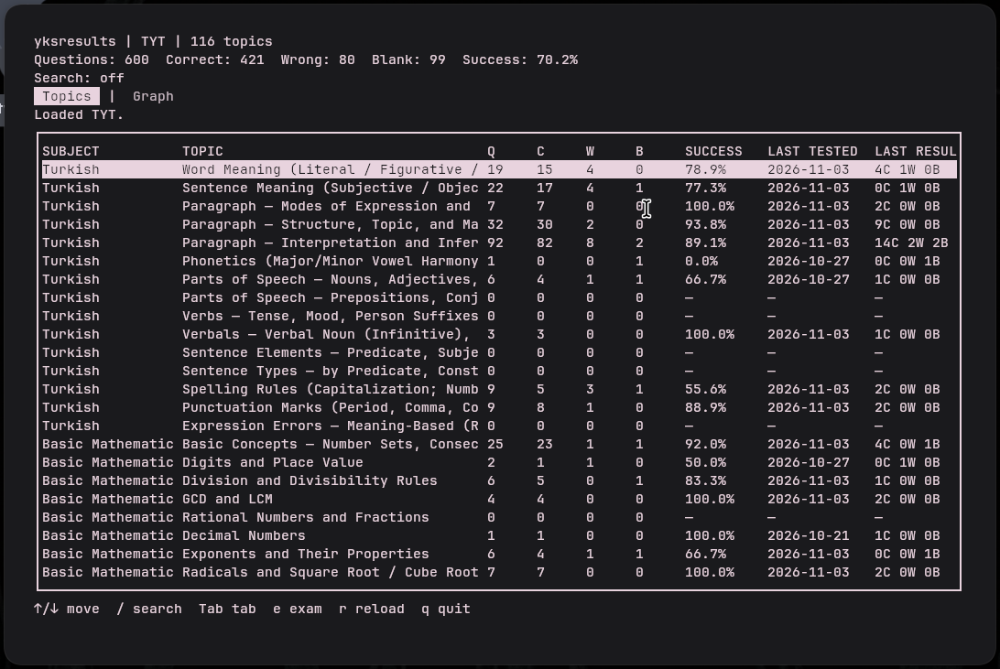
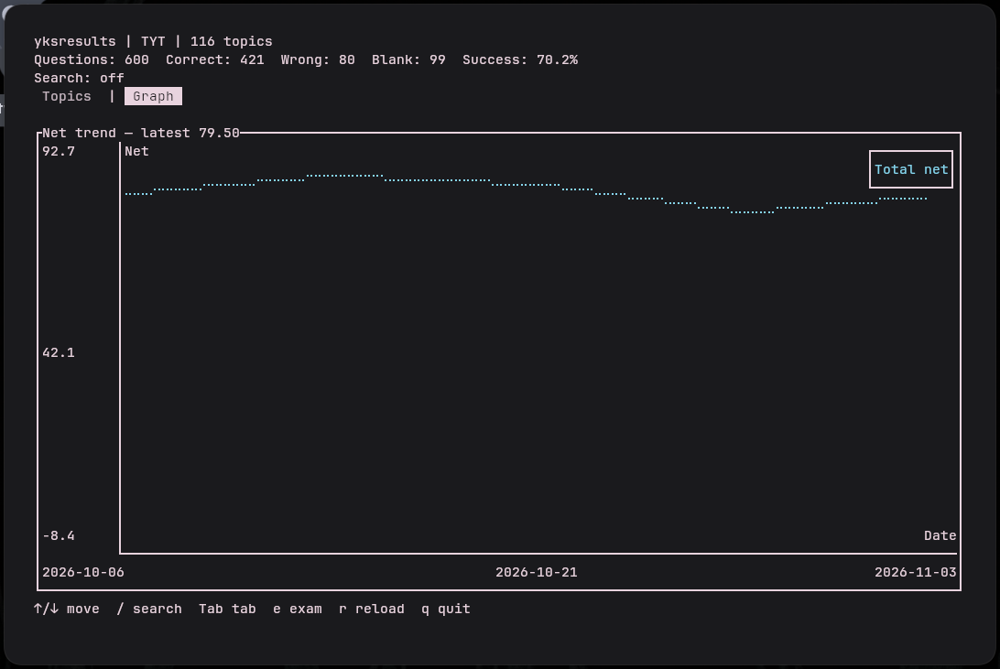

# yksresults

yksresults is a Rust terminal application for viewing TYT and AYT
rehearsal statistics across all subjects and tracks (Sayısal, Eşit Ağırlık, Sözel).
It imports Okulizyon HTML exports and shows, per topic, the question total and the
correct, wrong and blank counts with the calculated success rate, plus a summary across
all subjects. The two exams keep separate inventories and histories.

<p align="center">
  
  <br>
  <em>Topics tab: per-topic TYT question and result statistics.</em>
</p>

<p align="center">
  
  <br>
  <em>Graph tab: total-net trend across archived TYT analyses.</em>
</p>

## Requirements

- Rust 1.95 or newer and Cargo (edition 2024)
- Linux, macOS, or Windows 10+
- A terminal emulator

## Usage

Keys: arrows or `j`/`k` move through topics, `PageUp`/`PageDown` jump by 10,
`/` searches, `Tab` toggles the topics table and the total-net trend graph
(plotted from archived analyses), `e` switches exams, `r` reloads data, and `q`
quits. The TUI follows the system locale: Turkish locales (`tr`, `tr-TR`) show
Turkish labels and topic names, while other locales use English labels and
English topic names. Search matches names in both languages. Build an optimized
executable with `cargo build --release` (binary at `target/release/yksresults`,
or `target\release\yksresults.exe` on Windows).

CLI commands:

```bash
yksresults                 # Launch interactive TUI (same as `yksresults tui`)
yksresults report tyt      # Print TYT statistics report
yksresults report ayt      # Print AYT statistics report
yksresults report tyt --write   # Also write dashboard.md to the TYT data directory
yksresults import-tyt --file ~/Downloads/tyt-result_10.11.2026.html
yksresults import-ayt --file ~/Downloads/ayt-result_10.11.2026.html
yksresults --help          # Usage; --version prints the version
```

Without `--file`, `import-tyt` / `import-ayt` re-scan the exam's `results/` directory
and rebuild all statistics from every archived HTML file and analysis.

On first launch, the app initializes missing data files from `topics/`.
It never overwrites existing statistics and automatically adds subjects and topics that
were newly added to `topics/`.

## Application data

Runtime data is stored outside the repository:

- Linux and macOS: `${XDG_DATA_HOME:-~/.local/share}/yksresults/`
- Windows: `%LOCALAPPDATA%\yksresults\`

It contains:

- `tyt-topic-tracker/` — TYT topics, results, and analyses
- `ayt-topic-tracker/` — AYT topics, results, and analyses

## Topic inventory

The topic lists in `topics/tyt.json` and `topics/ayt.json` were compiled from
the following sources:

| Source                                                                 | URL              |
| ---------------------------------------------------------------------- | ---------------- |
| MEB Türk Dili ve Edebiyatı Öğretim Programı                            | meb.gov.tr       |
| ÖSYM YKS Kılavuzu                                                      | osym.gov.tr      |
| ailevegitim.com — TYT/AYT konu listeleri                               | ailevegitim.com  |
| derslig.com — TYT Matematik, Geometri, AYT Geometri konu listeleri     | derslig.com      |
| erinakademi.com — AYT Sayısal tam konu listesi                         | erinakademi.com  |
| dopinghafiza.com — TYT Geometri & AYT Analitik Geometri konu listeleri | dopinghafiza.com |
| kitapsec.com — TYT Geometri soru dağılımı                              | kitapsec.com     |
| tahtaapp.com — TYT Türkçe, Sosyal Bilimler konu listeleri              | tahtaapp.com     |
| superprof.com.tr — TYT Fen & Sosyal konu listeleri                     | superprof.com.tr |
| miletakademi.net — AYT Matematik konu listesi                          | miletakademi.net |

- **TYT** covers 9 subjects: Türkçe (40q), Temel Matematik & Geometri (40q),
  Fizik (7q), Kimya (7q), Biyoloji (6q), Tarih (5q), Coğrafya (5q),
  Felsefe (5q), and Din Kültürü ve Ahlak Bilgisi (5q).
- **AYT** covers all 11 subjects across all tracks:
  - _Türk Dili ve Edebiyatı - Sosyal Bilimler-1 (40q):_ Türk Dili ve Edebiyatı (24q), Tarih-1 (10q), Coğrafya-1 (6q)
  - _Matematik (40q):_ Matematik & Geometri (40q)
  - _Fen Bilimleri (40q):_ Fizik (14q), Kimya (13q), Biyoloji (13q)
  - _Sosyal Bilimler-2 (40q):_ Tarih-2 (11q), Coğrafya-2 (11q), Felsefe Grubu (12q), Din Kültürü ve Ahlak Bilgisi (6q)

## Okulizyon HTML import

Pass the exported HTML file directly with `--file`. The importer reads it in
place, copies it into the application's `results` directory for archiving,
writes a parsed analysis JSON to `analysis/`, and updates topic statistics.

The rehearsal date is automatically extracted from `DD.MM.YYYY` in the filename
(for example `tyt-result_10.11.2026.html`). If the filename has no date, the import
fails unless you pass `--date YYYY-MM-DD`; the archived copy then gets the date appended:

```bash
yksresults import-ayt --file ~/Downloads/ayt-result.html --date 2026-11-10
```

Two exams with the same date and the same name (first 25 characters, slugified) share one
analysis file; the importer refuses to overwrite it with a different HTML file.

## License

MIT. See [LICENSE](LICENSE).
